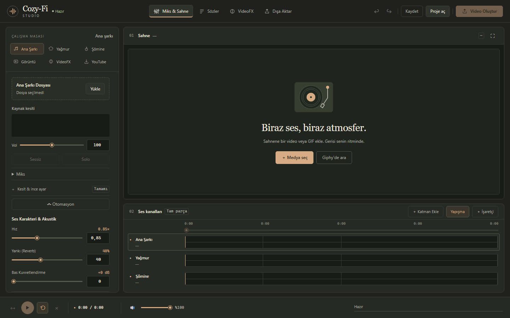

# Cozy-Fi Studio

A browser-based, single-user studio for turning music into ambient videos. Mix audio layers, build a visual scene, edit synchronized lyrics, and export MP4 videos from the same canvas renderer used by the preview.

The interface is in Turkish. Audio processing and transcription run on your machine. Optional searches and downloads use external services.



## Features

- Multitrack audio with trim, looping, volume automation, fades, ducking, EQ, reverb, and speed controls.
- Video and GIF backgrounds, multiple clips, transitions, image overlays, and audio-reactive effects.
- Shared zoom/pan timeline, frame stepping and editable timecode, visual clip trims, split/duplicate/ripple commands, and a searchable media library.
- Canvas selection, proportional resize/rotation handles, non-destructive source crop with aspect presets, mirroring, centering, and preview-only alignment/safe-area guides.
- Project-time position, zoom, rotation and opacity keyframes, with draggable timeline diamonds, frame/second entry and matching preview/export interpolation.
- Independent linear, ease-in/out, smooth, hold and Bézier intervals for audio automation and video keyframes; shared curve inspectors with numeric, keyboard and draggable Bézier controls.
- Expandable audio automation canvas, freehand pencil, box/list multiselection, group movement and cross-track point copy/paste; independent level ranges and frame/beat/marker snapping.
- Live volume automation recording with read/touch/latch modes, a precise recording fader, selectable punch range, live monitoring and one-step undo.
- Independent volume, stereo pan, low-pass cutoff and layer reverb curves, with a parameter selector and synchronized overview lanes; per-layer effects also apply to exported audio.
- Per-layer three-band parametric EQ with a draggable frequency-response graph, numeric frequency/gain/Q controls, feedback delay, reorderable EQ/filter/reverb/delay stages and individual bypass.
- Project-wide BPM, tap tempo and local tempo suggestions, an adjustable first beat, bar/subdivision grid, clip and transition alignment, and shared automation beat snapping.
- Nine visual transition presets including zoom and blur, directional wipe/slide/circle transitions, temporal softness, touch/keyboard overlap handles, and transition-region playback loops with matching MP4 output.
- Independent clip color grades with exposure, white balance, tonal controls, editable master/R/G/B curves, reusable looks and color copy/paste; draggable before/after comparison with matching MP4 rendering.
- Up to 16 independent video/GIF/image/text scene layers with timeline lanes, stack order, groups, locks, visibility and nine blend modes; precise canvas transforms, looping/source trims and portable media packages.
- Lyrics editing, LRC/SRT import and export, manual timestamps, and local Whisper transcription.
- Project packages (`.cozy`), browser draft recovery, undo/redo, short preview renders, and MP4 export.
- Optional YouTube import, Giphy search, and LRCLIB lyrics search.

Each audio inspector includes **Ses otomasyonu**. Choose volume, stereo pan,
low-pass cutoff or layer reverb, then apply a preset or add points at the playhead.
Drag points or enter their time and value directly. Expand **Tüm parametre şeritleri**
to see all four curves together and switch parameters by clicking a lane.
Curves follow project time independently of source trim and zoom, and combine
with fades in both preview and export. A drag is one undo step. Removing the
curve restores that parameter's static value; existing project curves remain compatible.
Live recording currently writes the volume parameter. The new layer effects are
separate from the existing main-song effect controls.

Open **Katman efekt zinciri** in any audio inspector to shape that layer's sound.
Select an EQ band and drag its handle, or enter frequency, gain and Q directly.
Use the stage arrows to change the processing order and clear **Etkin** to bypass
an effect while retaining its settings. Delay has independent time, feedback and
amount controls. The chain is saved in projects/packages and applied to exported audio.

Open **Ritim** in the timeline toolbar for BPM, first beat, beats per bar and
subdivisions. Tap at least three times, then apply the result, or use **Tempo öner**
to analyze up to 90 seconds of the main montage from the playhead locally.
Suggestions need explicit application and may need a first-beat correction.
Enable **Ritim çizgilerini göster** and **Ritme yapış** for the shared grid;
automation's beat mode uses these same project settings. BPM does not change
playback speed or automatically move existing edits.

The timeline viewport also controls the automation editor. Video clips can be moved
and trimmed directly, including intentional gaps. Auxiliary audio splits retain
source phase, fade envelopes and automation. Main-song clips support split,
move, trim, duplicate, copy/paste and ripple delete; source lyrics follow each
edited occurrence. The composed main sequence provides the project clock and
retains the speed/pitch controls and effect chain. Level controls support
percent/dB; the video precision panel supports
pixels, percentages and seconds/frames. See [editing controls](docs/EDITING.md)
and the [completed 20-feature roadmap](docs/FEATURE_TODO.md) for usage and scope.
The [next 30 features](docs/FEATURE_TODO_NEXT.md) cover new editing and production tools.

## Requirements

- Python **3.10–3.12**. Local validation uses Windows x64 and Python 3.10.
- **FFmpeg 6 or later and FFprobe** on `PATH`, with H.264/AAC encoding support.
- Playwright Chromium, installed with the command below. Chromium is required for video export, even when using a different browser for the interface.
- Several GB of free disk space for media, temporary renders, and optional transcription models.
- Node.js 22 or later only for JavaScript tests; no frontend build step is required.

## Quick start

```sh
git clone https://github.com/mustafaata/cozy-fi-studio.git
cd cozy-fi-studio
python -m venv .venv
```

Activate the environment:

```powershell
# Windows PowerShell
.\.venv\Scripts\Activate.ps1
```

```sh
# macOS / Linux
source .venv/bin/activate
```

Install and start:

```sh
python -m pip install --upgrade pip
python -m pip install -r requirements.txt
python -m playwright install chromium
ffmpeg -version
ffprobe -version
python serve.py
```

On Linux, use `python -m playwright install --with-deps chromium` to install Chromium's system dependencies. Open **http://127.0.0.1:5000**. Upload audio and a video/GIF background, adjust the scene, and export. `python app.py` starts the same Waitress server.

No API key is needed for local editing or rendering. Transcription downloads the selected model on first use; the model download needs internet access. WhisperX alignment is optional and disabled unless you separately install a compatible WhisperX environment.

## Configuration

Set environment variables in your shell or service manager. `.env.example` documents them; **`.env` files are not loaded automatically**.

| Variable | Default | Purpose |
| --- | --- | --- |
| `GIPHY_API_KEY` | Empty | Enables optional Giphy search; never sent to the browser. |
| `COZY_PORT` | `5000` | Local HTTP port, from 1 to 65535. |
| `COZY_DATA_DIR` | Project directory | Root for media, downloads, outputs, and models. Relative values are project-relative. |
| `FFMPEG_BINARY` | Automatic discovery | Optional FFmpeg executable path. |
| `FFPROBE_BINARY` | Beside FFmpeg or on `PATH` | Optional FFprobe executable path. |

For example, in PowerShell:

```powershell
$env:COZY_DATA_DIR = './data'
$env:COZY_PORT = '5000'
python serve.py
```

Configure optional API credentials outside source control. Never paste a real key into Python, JavaScript, a README, or an issue.

## Running on a private server

The supported deployment is **one trusted user and one application process**. Waitress binds to loopback. The application also rejects remote peers, unexpected hosts, and cross-origin browser requests. All jobs share the same workspace; this is not a multi-user service.

Use an authenticated SSH tunnel from your computer:

```sh
ssh -N -L 5000:127.0.0.1:5000 user@your-server
```

Then open `http://127.0.0.1:5000` locally. Do not expose the application through a public port, unauthenticated reverse proxy, or public tunnel. A proxy can appear as a loopback peer and remove the intended access boundary. Run under an unprivileged OS account with access only to its workspace. Use your OS service manager for restart supervision.

Jobs run in background threads with in-memory state. Do not launch multiple WSGI workers or use a reloader. Restarting stops active jobs and loses their status; completed files remain on disk. Back up `.cozy` packages and source media. Monitor disk usage and remove unused assets while the application is stopped.

There is no separate frontend production build: Waitress serves the checked-in assets with the same security headers. See [security notes](SECURITY.md) and [validation](docs/VALIDATION.md).

## Data and privacy

These directories are created as needed beneath `COZY_DATA_DIR` and excluded from Git:

| Directory | Contents |
| --- | --- |
| `src/music/` | Downloaded audio |
| `outputs/` | Completed videos |
| `.media/` | Imported media, previews, and overlays |
| `.models/` | Local transcription models |

Temporary work uses the operating system's temporary directory. Drafts are stored in the browser. Do not clear browser storage until you have exported needed projects.

Giphy receives GIF searches, LRCLIB receives song metadata searches, and YouTube receives search/download requests. Google Fonts supplies optional interface fonts. Transcription models are downloaded from Hugging Face; transcription audio is processed locally. Only import and distribute media you have permission to use.

## Tests

After installing dependencies and Chromium:

```sh
python -m unittest discover -s tests -p "test_*.py" -v
node --test tests/*.test.cjs
python -m pip check
```

The Python suite includes real FFmpeg exports and browser checks and can take several minutes. On Windows shells that do not expand wildcards, use:

```powershell
node --test (Get-ChildItem tests/*.test.cjs).FullName
```

For a dependency vulnerability scan:

```sh
python -m pip install pip-audit
python -m pip_audit -r requirements.txt
```

## Project structure

The 30 additional editing features (21–50) are implemented. See [feature checklist](docs/FEATURE_TODO_NEXT.md), [editing guide](docs/EDITING.md), and [validation results](docs/VALIDATION.md). Nested and linked sequence editing is in the main-source inspector; LUFS measurement, audition and export targets are in the Output inspector.

- `app.py`, `package_api.py`, `sample_api.py`: HTTP endpoints and background jobs.
- `settings.py`, `security.py`, `serve.py`: configuration, request boundaries, and production entry point.
- `engine.py`, `audio_render.py`, `canvas_render.py`: audio processing and final export.
- `media_assets.py`, `overlay_assets.py`, `project_package.py`: validated assets and portable packages.
- `project.py`, `static/project-schema.json`: shared project contract.
- `lyrics.py`, `lyric_*.py`, `transcription*.py`: lyrics and local transcription.
- `static/js/`, `static/css/`, `templates/`: browser editor and shared scene renderer.
- `tests/`: Python, browser, and JavaScript regressions.

## Third-party components

See [THIRD_PARTY_NOTICES.md](THIRD_PARTY_NOTICES.md) for bundled library and font licenses. Music, videos, generated outputs, machine-specific environments, and model weights are not distributed in this repository.

No license has yet been selected for the project's own source code. Public visibility alone does not grant a general license to reuse it; third-party components retain their respective licenses.
